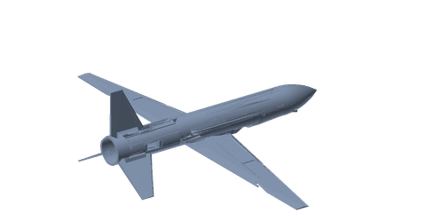
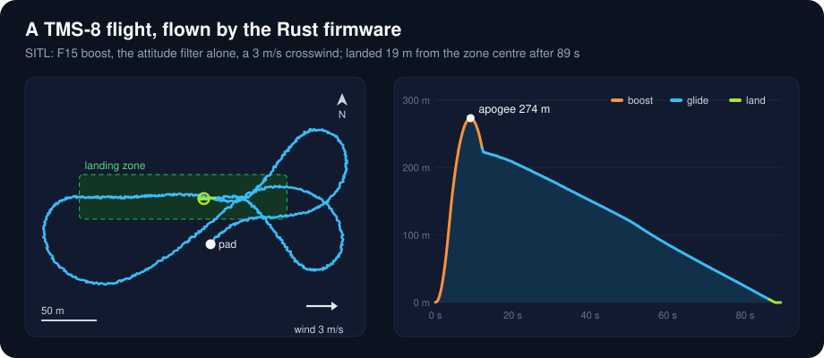
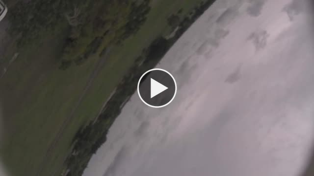
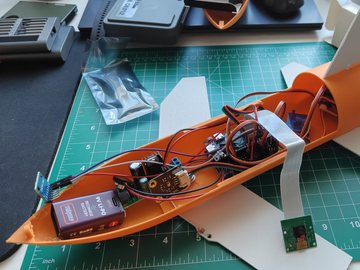
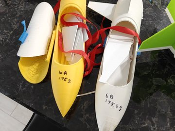
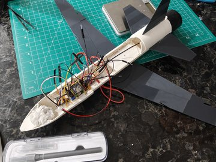

# Coludo

### A rocket-boosted glider that flies itself home

A small model rocket carries a 3D-printed glider a few hundred metres up. Near the top the two part, and the glider
finds its own way back down to a marked strip of field: no pilot, no one steering it, just the flight computer on
board, its GNSS, barometers, a pitot tube and an attitude filter it runs itself.

Everything here is home-built: the airframes (designed and printed, TMS-1 to TMS-7 so far), the flight computer's
firmware, the ground station, the simulator it is tested in, and the flight recorders.

## How a flight goes

  

That card is the real flight firmware flying the simulator: boost to 274 m, separate, glide out, and orbit down onto
the zone in a crosswind. The same code flies the boards hardware-in-the-loop, with the simulator feeding their
sensors over Wi-Fi ([`doc/sims/`](doc/sims/) holds a few hundred of those flights).

## First launch day — 3 October 2026

<table>
<tr>
<td width="48%">

</td>
<td>

**[TMS-7](launches/20261003/TMS-7/README.md)**, the booster alone on the strongest motor, flew clean and came down
under its chute with a nose logger aboard:

| | |
|---|---|
| peak acceleration | **14.9 g** |
| top speed | **125 m/s**, Mach 0.36 |
| apogee | **464–479 m** |

**[TMS-7C](launches/20261003/TMS-7C/README.md)**, the first instrumented glider, lost its boost stability just off
the rod, looped and was down within five seconds. Its on-board camera saw all of it (▶ the picture).

</td>
</tr>
</table>

## From TMS-4 to TMS-7

<table>
<tr>
<td align="center"> <b>TMS-4</b> — the first one with electronics</td>
<td align="center"> <b>TMS-6</b> — the <a href="doc/videos/tms-6/">6a/6b/6c campaign</a></td>
<td align="center"> <b>TMS-7</b> — folding wings and a flight computer</td>
</tr>
</table>

Next is **TMS-8**: a new glider with fixed wings, for the launch on **5 December 2026**.

## MicroPython first, Rust now

Coludo's flight firmware was born in **MicroPython** ([`src/glider`](src/glider/), now called *plan B*): quick to
write, easy to test on the board, and it flew the first launch day. Its garbage collector, a ~10 ms scheduling floor
and a tight heap kept shaping the design, so in October 2026 the firmware was rewritten in **Rust** on the same
ESP32-P4 board ([`src/avionics`](src/avionics/)), milestone by milestone, each one held to plan B's own behaviour:
golden vectors, the simulator, and flights on the boards. MicroPython stays for the tools, the tests and TMS-7C.

- **100 Hz control loop** on its own core, paced by a timer interrupt, with no locks in its path.
- **Its own attitude filter** (a quaternion, the gyro's bias learned on the pad), and a lean law that holds the boost
  near vertical.
- **Back in control about a second after a reset**, and a mid-air reset resumes the flight where it was (a *warm
  start*) instead of falling out of the sky.
- **A separate flight recorder** (ESP32-C6, own battery and SD card) that keeps the log and a radio beacon going even
  if the main board is lost ([`doc/flight_recorder.md`](doc/flight_recorder.md)).

## Where things live

**Specifications — [`doc/specs/`](doc/specs/)**
- [Architecture overview](doc/specs/coludo.md) — the **main description**: the flight lifecycle (Setting → Boosting →
  Gliding → Landing → Done), the flight controller, sensors, telemetry and logging. Authoritative for flight behaviour;
  the Rust firmware's deliberate differences are listed in the port plan.
- [Rust avionics port](doc/specs/avionics-port.md) — the plan B → Rust port: milestones, decisions, proofs.
- [Avionics refactor](doc/specs/avionics-refactor.md) and [boost control](doc/specs/boost-control.md) — the port's
  structure, and control in BOOSTING (the lean law).
- [Board configuration](doc/specs/board-config.md) — the config schema, the three config layers, and the save/reboot
  activation lifecycle.
- [Control Center ↔ board protocol](doc/specs/cc-protocol.md), [recorder wire format](doc/specs/recorder-wire.md) and
  [sim-link](doc/specs/sim-link.md) — what goes over the wires: commands, logs, and the simulator's frames.

**Documentation — [`doc/`](doc/)**
- [Hardware](doc/hardware.md) — parts, weights, power budget and the main-board revisions.
- [Flight recorder](doc/flight_recorder.md) — the separate ESP32-C6 recorder: log, beacon, battery.
- [Field checks](doc/field_checks.md) — what a launch day verifies on the Rust stack (GNSS fix, beacon range, battery).
- [Data sources](doc/datasources.md) — every measured quantity with its primary source, backups and rates.
- [Pin map](doc/waveshare_esp32p4_pins.md) — generated from the board config: the bus and GPIO maps, reserved pins.
- [Tasks & plans](doc/plan.md) — required hardware and the phased roadmap.
- [Development & testing guide](doc/skills.md) — plan B and Rust board tooling, `tools/cc.py` scripting, the `panda`
  test network, the coding conventions and testing rules.
- [Flight simulations](doc/sims/) — closed-loop flights of plan B and of the Rust firmware (HITL over the sim-link,
  SITL), with interactive reports; newest first.
- Generated references: [Rust API](doc/avionics_api.md), [plan B API](doc/glider_api.md),
  [architecture](doc/architecture.md), [telemetry](doc/telemetry.md) (`make docs`).
- [Benchmarks](doc/benches/) — the ESP32-P4 on MicroPython and on Rust, the GNSS bench, early SBC logs.
- [Photos](doc/photos/) and [videos](doc/videos/) — builds and the TMS-6 campaign; launch-day footage sits with its
  launch.

**Launches — [`launches/`](launches/README.md)** — one folder per launch day: the manifest, every board config as it
flew, and afterwards the flight data, plots and video ([2026-10-03](launches/20261003/README.md); next:
[TMS-8](launches/next/TMS-8/README.md)).

**Models — [`models/`](models/)** — 3D-printable STL parts (TMS-1 … TMS-7, the catapult) and the main-board PCBs.

**Source — [`src/`](src/)**
- [`src/avionics/`](src/avionics/) — the flight firmware in Rust: the ESP32-P4 board firmware, the host-tested crates,
  the SITL, and the C6 flight recorder.
- [`src/glider/`](src/glider/) — plan B, the MicroPython flight firmware (frozen at tag `micropython_plan_B_3`, still
  flown by TMS-7C), the reference the port was checked against, and the simulator's physics (`sim_model.py`).
- [`src/control/`](src/control/) — the Control Center ground station (Python) and its browser dashboard.
- [`src/logger/`](src/logger/) — the standalone nose logger (ESP32-C6 + SEN0697 + LiPo, MicroPython), flown on TMS-7.
- [`src/camera/`](src/camera/) — plan B's Luckfox Pico recorder (TMS-7C).
- [`src/gnss_bench/`](src/gnss_bench/README.md) — a GNSS field checker (ESP32-C6, MicroPython).

**Tools — [`tools/`](tools/)** — board operations (`cc.py`, `deploy.sh`, `provision.sh`, `ota.py`), simulation
(`hitl_host.py`, `sitl_matrix.py`, `virtual_flight.py`, `boost_sweep.py`), flight data (`recorder_flight.py`,
`flight_report.py`, `board_pull.sh`), and the pictures above (`render_model.py`, `render_flight_card.py`).
`make check` runs every local gate (there is no CI).
