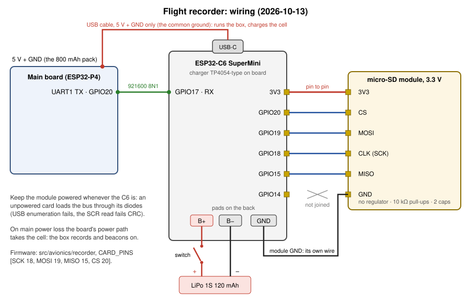

# Flight recorder (M19/M20): composition and pinout

The flight recorder is a small separate box that keeps a copy of everything the glider records and is the glider's
second recovery beacon. The data must survive when the main board and its SD card are both damaged. It has its own
battery and card and is mounted apart from the main board. Its link to it is the main board's UART TX and a USB
cable carrying the main pack's 5 V and GND (the common ground, no data): the pack runs the box and charges its cell
through the flight, and when the main power fails, shorts or sags, the C6's power path hands the box to its own cell.
It replaced the Luckfox recorder in October 2026, and the boxes can be swapped.

Firmware: `src/avionics/recorder` (Rust, ESP-IDF 5.5.5, package `flight_recorder`). Design and status:
`doc/specs/avionics-port.md` M19 (the main board's uart_saver) and M20 (this box and its beacon).

## Composition

| part | what it is | notes |
|---|---|---|
| MCU | ESP32-C6 SuperMini (a clone) | Wi-Fi for the beacon, USB-Serial-JTAG console, LiPo charging pads on the back |
| card | a 3.3 V-only micro-SD SPI module (no regulator; 10 kOhm pull-ups and two capacitors on board) | on the C6's **3V3**, soldered pin to pin on its right header (see Pinout); since 2026-10-13 |
| battery | 1-cell LiPo, 120 mAh planned (300 mAh for longer searches) | on the C6's B+/B- pads: its charger fills it from USB |
| switch | a power switch in the battery lead | cuts the battery off when the box is stored |
| supply in flight | a USB cable from the main board's supply | runs the box and charges the cell while the main board has power; the cell carries on after |

## Pinout

| from | to | signal |
|---|---|---|
| main board (P4) GPIO20 | C6 GPIO17 (its RX pin) | UART1, the uart_saver's lines, **921600 baud 8N1**, one way |
| main board 5 V + GND | C6 USB-C (VBUS + GND, no data) | the box's supply in flight, and the common ground |
| C6 3V3 | card 3V3 | the module has no regulator |
| C6 GPIO20 | card CS | SPI2 |
| C6 GPIO19 | card MOSI | SPI2 |
| C6 GPIO18 | card SCK | SPI2 |
| C6 GPIO15 | card MISO | SPI2 |
| C6 GPIO14 | (nothing) | the header pin facing the module's GND |
| C6 GND | card GND | its own wire: GPIO14 is no ground |

The first five are the C6's right header in the module's own pin order, so the module solders on pin to pin. GPIO15
is a strapping pin only once EFUSE_JTAG_SEL_ENABLE is burned, and the module's pull-up then selects USB-JTAG, the
default. The C6's GPIO20 is the card's CS. It isn't the main board's GPIO20, which is that board's UART TX: two
different chips that happen to share a pin number.

The link is the main board's recorder lines, one way at 921600 8N1: each line `@routing@{OPEN};payload;<CLOSE>` with its
CRC (`crates/recorder_wire`, `doc/specs/avionics-port.md` §3.10), the same bytes the main board's ring_saver files on
its own card. The box only listens.

## Power

- **The card runs from the C6's 3V3** (2026-10-13): the module has no regulator, so the LiPo needs no boost. It
  mounts at 20 MHz SPI with no extra capacitor. The first module (WWZMDiB) carried its own 3.3 V regulator and wanted
  5 V: on 3.3 V the card answered CMD0 and CMD8 but sat in ACMD41's idle state until the 3 s timeout.
- **The module must always be powered.** With its 3V3 lead off, the card is fed through its protection diodes from
  the bus lines: the C6 then failed USB enumeration (-71), and once up the card answered its init but its SCR read
  failed CRC with the same bytes on every try.
- **Battery time (estimate, ESP32-C6 datasheet v1.5).** The beacon's access point keeps the receiver on: about
  80-85 mA. The operator's 60 s on / 60 s off cycle averages ~41 mA plus the off minute's draw, so a 120 mAh cell
  lasts ~2.1-2.4 h, against ~1.2 h always on. Measuring it is open: a LiPo run timed to the last beacon.

## Firmware and tools

- Flash only with its own script, from a direct USB port. Through the hub, long transfers corrupt. The image is
  ~1.5 MB; IDF's default 1 MB slot boot-loops.
  `PORT=/dev/ttyACMn src/avionics/recorder/flash.sh src/avionics/target/riscv32imac-esp-espidf/release/flight_recorder`
- Find its port by the sysfs USB serial (10:BD:A3:AC:E1:F4 on the bench one). Never esptool-probe every port: its
  connect resets any ESP32 it reaches. Open the console with DTR and RTS both held (pyserial `dtr=True, rts=True`);
  releasing them one at a time resets the board.
- The console: `tools/recorder_console.py ls|df|rm|get|pull` lists, measures, removes and pulls the card's files.
  Each pull is checked by size and CRC-32.
- A status line every 5 s on the console: bytes and lines in, good and damaged, card errors, the beacon's state.

## What it does

- **Files:** each line where the main board's ring_saver files it, byte for byte: `<session>/recordings/...`,
  `sessions.csv`, `recorder.log`, `damaged.log` for a line that fails its check. A session closed by a reboot or a
  panic matched the main board's card in every file (20/20, 21/21). A line sent again after a main-board reboot is
  dropped (every file's lines rise in uptime).
- **Beacon:** the main board reports in `beacon.csv` every 5 s. From the rod trigger (or any stage past SETTING) to
  power-off the box is `<BOARD>_beacon` on Wi-Fi channel 6, 60 s on and 60 s off, 20 dBm. Its page is the glider's
  own: the last fix, a map link, every elevation source, the battery. The last report is kept on the card and
  replayed at boot, so a box that resets after an impact beacons again 0.6 s later. It never beacons in a HITL
  flight.

## Design (M20, the operator 2026-10-06)

The operator builds a C6 + battery + SD card box; the receiver firmware is Rust (esp-idf on the C6, riscv32imac) and
reuses `recorder_wire` (line verify, routing). It plugs in where the Luckfox sits now, and the boxes can be swapped.

- Receiver: reads the uart_saver's lines (M19), verifies each line's CRC, and writes the session layout that recorderd
  writes (§3.10) to its own SD card.
- Beacon by data, not by protocol: the main board adds an ordinary recorder stream, `beacon.csv`. Its rows are what a
  finder needs, about once a second and on every change: the last good fix (latitude, longitude, GNSS altitude, fix
  age), every elevation source (each baro, laser AGL), the stage, and the battery voltage where an INA226 is fitted. The
  P4 keeps writing it through the flight and just before.
- The receiver knows that one stream by its routing (`beacon.csv`) and keeps the latest row. When it beacons, it serves
  that position: the same page as M11b (last fix, a Google Maps link, the elevation sources) from an open AP
  `<BOARD>_beacon` on channel 6, at maximum TX power.
- The P4 controls it (operator), all through `beacon.csv` lines:
  - when it starts;
  - the network name: `<BOARD>_beacon`, beside the P4's own `<BOARD>_glider`;
  - the channel: low channels, 6 for the recorder and 3 for the P4, so the two never share one;
  - the page data: position, elevation from every source, stage, battery.
- It starts BEFORE launch: once the glider is installed on the rod, the P4 turns on the camera and the recorder's beacon
  together (the rod trigger, M9; until M9, `arm`). A P4 that dies in flight no longer matters, because no trigger is
  owed after launch.
- Once on, it stays on until power-off. The last report is kept on the recorder's card (its root `beacon.csv`: the
  operator chose a file over NVS, 2026-10-11) and replayed at boot, so a recorder that reboots (an impact, a brown-out)
  beacons again at once, under the same name and channel. Only the P4's next session in SETTING turns it off.
- The page shows the latest `beacon.csv` row: the pad position before launch, the last fix after.
- Battery (ESP32-C6 datasheet v1.5, Tables 5-7 and 5-10):
  - A SoftAP keeps its receiver on, so it cannot modem-sleep. Wi-Fi RX is 78 mA at any CPU clock (80 MHz is the floor
    for the Wi-Fi PLL). The beacon frames add about 4 mA (a ~1 ms frame at 1 Mbps every 102 ms, 354 mA at 21 dBm), so
    the AP draws ≈ 80-85 mA.
  - The modem-sleep figures (14-38 mA at 80-160 MHz) hold only with Wi-Fi clock-gated: a station between DTIMs, or the
    recording phase before the beacon starts.
  - A 120 mAh LiPo (about 85 % usable) gives ≈ 1.2 h of continuous AP, short of the 1.5-2 h search target.
  - Chosen (operator): Wi-Fi 1 minute on, 1 minute off. On average ≈ 41 mA plus the off-minute's draw: about 0.2 mA in
    light sleep, or 14 mA with the CPU idle in modem sleep. A 120 mAh cell then lasts ≈ 2.1-2.4 h, against ≈ 1.2 h
    always-on. The AP stays on while a phone is connected, and a searcher waits at most a minute to see it. That fits
    how a search goes (operator): you walk to the approximate location and circle the trees nearby, so sooner or later
    an on-minute is caught. The parts are more often in the grass or stuck in a tree, which is why the page shows every
    elevation source beside the position. A 300 mAh cell remains the option for longer searches.
  - The beacon frames add little either way: the receiver is the cost.
- The same `beacon.csv` rows can feed the P4's own beacon at DONE (M11b), so both beacons show one data set.
- Two beacons by design: two radios, two antennas, two batteries, two mounting spots. One that is buried, shadowed or
  flat does not hide the glider. Both run at once from DONE (the recorder's has been on since the rod). Each has its own
  SSID and channel (`<BOARD>_glider` on 3, `<BOARD>_beacon` on 6), so a phone sees which one answers and the signal
  strength of each, which helps walking in on the glider.

## Status

Stages 1-3 done 2026-10-11 on the taster and the C6 SuperMini; the card module swapped 2026-10-13.

- Receiver (`src/avionics/recorder`, package `flight_recorder`): files each line where the P4's ring_saver files it,
  byte for byte: a session closed by a reboot matched the P4's card in all 20 files. A line the P4 sends again after a
  reboot (no newer than its file's last: every file's lines rise in uptime) stays out; a header printed again stays out
  of a file that holds one (the global index: one per session); a torn last line gets its `\n`; a damaged line goes raw
  to the session's `damaged.log`. Console (below the link's loop; `tools/recorder_console.py` is the host's end, its
  port found by its USB product): `ls [dir]`, `df`, `rm <path>` (never the root nor the session being filed), `get
  <path>` (base64 lines, checked by size + CRC-32), `files [dir]` (size + CRC-32 of each file; `pull <dir>` gets them
  all) and `read <path> <offset> <length>` (hex). Its lines go through newlib's locked `stdout`, as the logger's do:
  written past that lock (`println!`), a reply landed inside a status line.
- Card: since 2026-10-13 a 3.3 V-only SPI module (10 kOhm pull-ups, no regulator) on the SuperMini's 3V3, soldered pin
  to pin on its right header: CS 20, MOSI 19, SCK 18, MISO 15, its GND a wire of its own; it mounts at 20 MHz with no
  extra capacitor. The first module, a WWZMDiB, carried its own 3.3 V regulator and wanted 5V: on 3V3 that card answered
  CMD0/CMD8 but never left ACMD41's idle. A mount is read back before any write. Flash with `recorder/flash.sh` (its own
  table: a 3 MB factory slot, the image is ~1.5 MB).
- Beacon (crates/beacon, one page and one report for both ends): the P4 writes beacon.csv every 5 s (radio: name,
  password, channel, TX cap, on/off cycle; page: fix, pad, every elevation source, laser AGL, battery, copy backlog).
  The name stays empty, the beacon off, until the rod trigger fires (armed in SETTING, nose up 2 s: the video's
  `Trigger`) or the stage passes SETTING; then `<BOARD>_beacon` on channel 6 (the glider's 3 + 3) at 20 dBm, 60 s on and
  60 s silent, until power-off. Never in a HITL flight. The receiver keeps every report in its card's root `beacon.csv`
  and replays the last one at boot (the operator, 2026-10-11, in place of NVS): proven, on the air 0.6 s after a reset.
  Its page is the glider's own, with how old the report is.
- Open: the battery time on a LiPo; the field range of the two beacons; the photos; the damaged lines (0.4-2 % of lines,
  whole byte runs lost, the same with the old module) measured again on the soldered unit before any firmware change:
  the bench link runs through three breadboard junctions and ~40 cm of wire at 921600 baud.

## Photos

To add (the operator): the assembled box from both sides, the SD module soldered on, the battery and switch.
