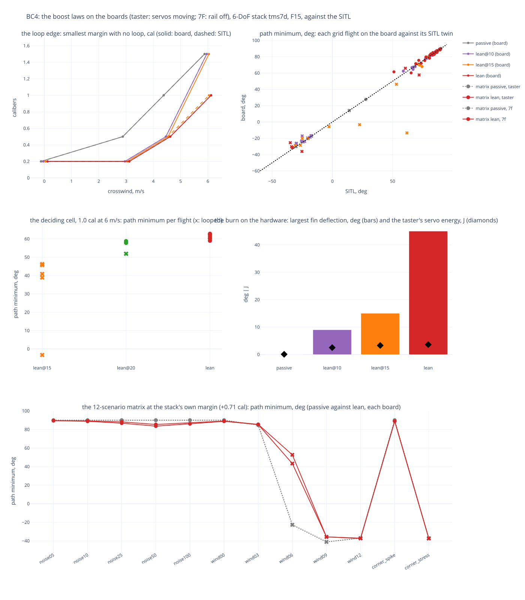

# TMS-7 — boost control on the boards (BC4): the lean law in realtime HITL, servos moving

**What it asks** ([`doc/specs/boost-control.md`](../../specs/boost-control.md) BC4): does the boost law BC3 built
hold up on the hardware, in realtime HITL with the servos moving, across BC2/BC3's grid and the 12-scenario matrix,
and against the SITL that designed it? BC5 (turning it on in the flight configs) is the operator's call on BC2-BC4.

**How it was flown (2026-10-13).** The 6-DoF boost (`tools/stack_dynamics.py`, the stack `tms7d`, the measured F15,
287 g glider) against a crosswind on the folded wings, noise 0.10, seeded. `tools/boost_sweep.py --boards` flew the
grid on two boards from one queue, the law set per flight over each board's own config (`hitl_host.py --boost-law`,
`--boost-limit`):
- **the taster**: servos moving (SG90 elevons, the MG90S yaw), the INA226 on their rail;
- **TMS-7F**: its servo rail off (`--no-power`), the fins commanded and recorded.

Each flight's score is the physics' (path minimum in the burn, worst lean, a loop = the nose below the horizon under
thrust, apogee, landing), as the SITL scores it. The SITL twin of every cell came from the same tool on cheeta.

| set | flights | what |
|---|---|---|
| the grid | 128 board | passive, lean@10, lean@15, lean x 0.2/0.5/1.0/1.5 cal x 0/3/4.5/6 m/s x 2 seeds |
| the deciding cell | 12 board | 1.0 cal at 6 m/s: lean, lean@20, lean@15, 4 more seeds each |
| the matrix | 24 + 23 board | the 12 scenarios of `hitl_matrix_host.sh`, passive against lean, at the stack's own margin (+0.71 cal), on each board (7F's lean noise100 never flew, below) |
| the SITL | 288 | passive, hold, lean, lean@10/15/20 over BC3's full grid (6 margins, 2 seeds) |

`lean@N` is the lean law under a boost ceiling of N degrees (below).

## 1. Found on the way: the lean law at the full 45 degrees under thrust

The first board flight showed it: the law engages at the rod gate's 15 m/s, where the airspeed governor still
allows the glide's 45 degrees, and the roll loop's damping sat at that cap through the burn (35, then 20, then 15
degrees as the speed rose). boost-control.md had the operator's +-10 degrees (2026-06-25) as the boost's own ceiling;
BC3 as built did not apply it. `f78715b` added it: the flight entry's `boost_limit_deg`, a ceiling on the governor's
cap in BOOSTING only (absent: none, plan B's cap). This study measures what each ceiling costs.

## 2. The board against the SITL

- **The loop verdict agrees in 125 of 128 grid flights**; where neither looped the path minimum agrees to a median
  of 0.0 degrees (-6.4..+10.4, 94 flights). The three that differ are all marginal cells, and all three looped on the
  board where the SITL did not: lean at 0.2 cal in 4.5 m/s (the SITL looped 1 of 2 there), and lean@15 at 1.0 cal in
  6 m/s twice. Two of them were late tumbles: the nose went past vertical (tilt 161-172 degrees) while the velocity
  still pointed up (path 46-58 degrees), and the burnout speed fell to 16-18 m/s.
- **Not a host artefact:** every flight's lag was 1.30-1.41 s, looped or not, so no stall hit a burn. In realtime
  the fins answer one Wi-Fi round trip later than in the lockstep SITL, and at the edge that is enough.

## 3. The envelope on the boards

The smallest static margin with no loop, at it and above (2 seeds a cell; [`envelope_board.svg`](envelope_board.svg),
the SITL's six laws in [`envelope_sitl.svg`](envelope_sitl.svg)):

| crosswind | passive | lean@10 | lean@15 | lean |
|---|---|---|---|---|
| calm | 0.2 cal | 0.2 | 0.2 | 0.2 |
| 3 m/s | 0.5 | 0.2 | 0.2 | 0.2 |
| 4.5 m/s | 1.0 | 0.5 | 0.5 | 0.5 |
| 6 m/s | 1.5 | 1.5 | **1.5** (SITL 1.0) | **1.0** |

**The deciding cell, 1.0 cal at 6 m/s** (the grid's 2 seeds and 4 more):

| law | loops | path minimum | apogee |
|---|---|---|---|
| lean, no ceiling | **0 of 6** | 59-63 deg | 142-169 m |
| lean@20 | 1 of 4 | 52-59 deg | 73-162 m |
| lean@15 | 6 of 6 | -3 to 46 deg, then the nose tumbles | 32-75 m |

- **A ceiling costs the 6 m/s gain on the board.** It binds only early in the burn: above ~29 m/s the governor's
  own cap is already under 15 degrees. That early authority is what stops the lean from building up. The SITL put
  the knee at 15 degrees; the board's latency moves it to 20 and beyond.
- **In calm air every law costs under a degree** of path (89-90 against passive's 90).
- The interactive flight reports of the deciding cell on the taster: [lean](report_cell_lean_m1_w6.html) (run 2) and
  [lean@15](report_cell_lean15_m1_w6.html) (run 1, a tumble).

## 4. The burn on the hardware

From the grid's flights (`flights_board.csv`):

| law | largest fin deflection in BOOSTING | the taster's servo rail, 3 s burn | its peak |
|---|---|---|---|
| passive | 0 deg | 0.08 J | 11 mA |
| lean@10 | 9 deg | 2.5 J | 832 mA |
| lean@15 | 15 deg | 3.3 J | 874 mA |
| lean | 45 deg | 3.6 J | 865 mA |

The ceilings hold on the hardware. The control tick stays easy through the boost: at most 19 us late and 0.73 ms of
work, no overruns.

## 5. The matrix at the stack's own margin

Each board flew the 12 scenarios at +0.71 cal, passive against lean, each compared within itself (7F's
`final_approach_agl` is 0, the taster's 8; `runs_matrix_taster.csv`, `runs_matrix_7f.csv`; the summary figure's
bottom panel):

| | taster: passive / lean | TMS-7F: passive / lean |
|---|---|---|
| flights (loops) | 12 (4) / 12 (4) | 12 (4) / 11 (4) |
| path minimum, median | 90.0 / 85.7 deg | 90.0 / 85.5 deg |
| miss, median; in the zone | 88.9 m, 1 / 88.6 m, 1 | 88.5 m, 0 / 90.0 m, 1 |

- **Where both fly** (calm, noise, 3 m/s, corner_spike) the lean law reacts to a noisy attitude: up to 6.4 degrees off
  the path minimum (taster; 4.6 on 7F) as the noise grows, and up to 4-6 m of apogee (179-183 m).
- **6 m/s loops either way** at this margin, as the envelope says (lean needs 1.0 cal there, passive 1.5). Lean gets
  further before it goes (path 43 and 53 degrees against -23, apogee 65-67 against 24 m), and on both boards it then
  landed in the zone (70 and 64 m) where passive did not. 9-12 m/s and corner_stress loop with both: no law saves
  0.71 cal in that wind.
- **The landing is unchanged:** median miss 88.5-90.0 m on both laws and boards, as the f15_full combo's figures at
  this mass ([TMS-7-preflight_rust](../TMS-7-preflight_rust/)).
- **noise100 on 7F launched on the pad, unarmed, in two of its three attempts** (the taster: none of three). At the
  matrix's heaviest noise the launch detector's leaky dwell (plan B's, built so a noisy real boost is still seen) can
  fill on noise alone. The first time the board launched AGAIN 140 ms after the harness's `stage setting`, on the last
  HITL sample its databoard holds for the quantity's 1 s window, so the restore was refused and the next flight could
  not install its config; `hitl_host` now waits the held samples out and confirms SETTING before it restores
  (`53c913c`), and the second time it recovered. The real IMUs' windows are 20 ms, so a held sample cannot fill the
  100 ms dwell on the hardware: a HITL artefact, not a flight hazard.

## 6. For BC5 (the operator's decision)

- **The lean law with no boost ceiling is the one that keeps its gain on the hardware:** the loop's edge moves from
  passive's 0.5 / 1.0 / 1.5 cal (3 / 4.5 / 6 m/s) to 0.2 / 0.5 / 1.0. A ceiling of 20 degrees is borderline (1 loop
  in 4 at the deciding cell), 15 and 10 give up the 6 m/s gain. The operator's +-10 of 2026-06-25 and these numbers
  disagree; the trade is the fins' load under thrust (45 degrees at 15 m/s) against the edge at 6 m/s.
- **What it costs:** under a degree in calm air, up to ~6 degrees of path with a noisy attitude, ~3.6 J of servo
  energy per boost, servo peaks ~870 mA.
- **Margin still dominates:** at TMS-7D's own +0.71 cal, 6 m/s loops with every law.

## Caveats

- The aerodynamics are BC1's fit (two flights, one stack, one wind plane, a 1 m rod), as in BC2 and BC3.
- Two seeds a grid cell (six at the deciding cell); single-seed edges move.
- The physics takes the commanded fin angles: no servo dynamics; the taster's servos moving shows the load and the
  energy, not the fins' lag.
- The taster hung once in a restart (flight 51 of the first pass, 2026-10-13 19:11: a silent hang, an EN reset
  recovered it); `boost_sweep` now retires a failing board and resumes, and the grid was completed.

## Files

- `bc4_summary.html` / `.svg`: the loop edges, board against SITL, the deciding cell, the burn, the matrix.
- `envelope_board.html` / `.svg`, `envelope_sitl.html` / `.svg`: per law, the margin x wind grid of the path minimum
  (LOOP where it looped) and the apogee; `summary_board.csv`, `summary_sitl.csv` behind them.
- `runs_board.csv` (the grid), `runs_edge.csv` (the deciding cell's extra seeds), `runs_matrix_taster.csv`,
  `runs_matrix_7f.csv` and their `matrix_summary_*.csv`, `runs_sitl.csv` (the SITL's 288).
- `flights_board.csv`: per board flight, the burn on the hardware (fin deflection, cap, the taster's servo energy and
  peak, the control tick's lateness and work) beside its SITL twin.
- `report_cell_*.html`: the interactive flight reports of the deciding cell.
