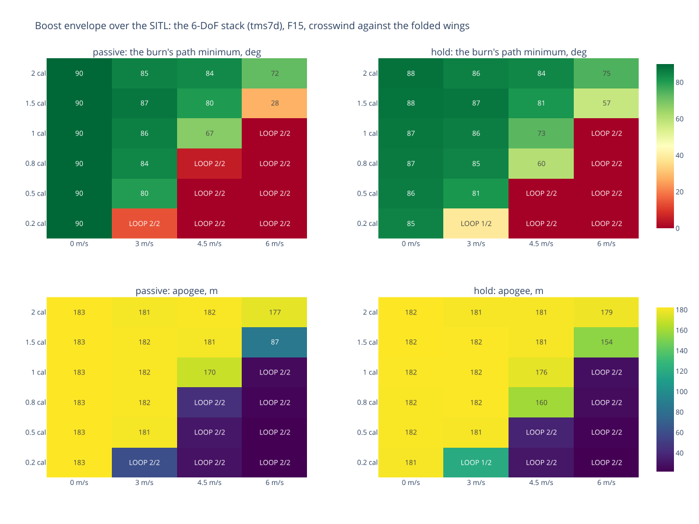

# TMS-7 — the boost envelope over the SITL: margin x crosswind, passive against the existing boost hold

**What it asks.** On 2026-10-03 7C looped under thrust and 7D bent over to a 32° path in a ~4.5 m/s crosswind
(`launches/20261003/`). The 6-DoF boost fitted to those two flights ([boost control](../../specs/boost-control.md)
BC1, `tools/stack_dynamics.py`) can now answer two questions the old vertical climb could not:
- **how much static margin a stack needs in a given wind**, flown passive (fins neutral, BOOSTING not a control stage);
- **how much the existing boost hold buys** (Rust `guidance::boost`: hold the attitude captured at BOOSTING entry, past
  15 m/s, under the speed-scaled fin cap).

**How it was flown.** `tools/boost_sweep.py`: the Rust flight code (the SITL) lockstep on `hitl_host.py --boost 6dof
--stack tms7d` (7D's mass and inertia, the fitted aerodynamics, the measured F15, a 1 m rod), its margin set per
flight (`--stack-margin`), the crosswind blowing against the folded wings' plane (the plane of 7C's 9.3 g side load),
sensor noise 10 %. The board config is the taster's HITL copy, twice: with `boosting` absent from the flight entry's
`stages` (passive) and present (hold). 2 laws x 6 margins (0.2-2.0 calibers) x 4 winds (0-6 m/s) x 2 seeded runs =
**96 flights**, all reaching DONE. Scored by the stack: the burn's path minimum (0.4 s to burnout), its worst lean,
whether the nose went below the horizon with the motor burning (a loop), the apogee. Data: `runs.csv`, `summary.csv`
(';'); the figure: `envelope.html` (interactive), `envelope.svg`.

## The headline

| crosswind | passive: no loop from | existing hold: no loop from |
|---|---|---|
| calm | every margin | every margin |
| 3 m/s | 0.5 cal | 0.5 cal (0.2 loops in 1 of 2) |
| **4.5 m/s** (10-03) | **1.0 cal** | **0.8 cal** (path 60°, apogee 160 m) |
| 6 m/s | 1.5 cal (path 28°, apogee 87 m) | 1.5 cal (path 57°, apogee 154 m) |

- **The existing hold is worth about 0.3 calibers.** It moves the loop's edge one margin step and, at the edge, roughly
  doubles the path minimum (6 m/s at 1.5 cal: 28° -> 57°; apogee 87 -> 154 m).
- **It cannot save a sub-neutral stack.** At 0.5 cal or less in 4.5 m/s or more, both loop. A stack with 7C's margin
  departs off the rod before the hold engages at 15 m/s, and the hold's authority, capped by the fin governor at speed,
  does not catch it.
- **In calm air the hold costs a little.** A stack that climbs straight passive (path minimum 90°) bottoms at 85-88°
  with the hold. It holds the Euler roll and pitch captured at entry, and near a vertical nose Euler roll and heading
  are both turns about the vertical: the roll loop chases that noise. The same representation problem keeps the hold
  from seeing which way the stack leans (`doc/specs/boost-control.md`, "The law has a representation problem").
- **Margin dominates.** Every calm cell climbs straight, every 2-caliber cell survives 6 m/s passive. The launch
  analysis's December list (≥ +1 caliber of effective margin, a longer rail, a wind limit) holds here with numbers:
  at 4.5 m/s, 1.0 caliber passive is the edge; 2 calibers clears 6 m/s.

## Caveats

- One stack (7D's), one wind plane (the folded wings', the worse one), one rod (1 m). The 6-DoF's passive envelope on
  a 2.5 m rail moves the edge ~0.2-0.3 calibers (BC1's host sweep); not flown here.
- The aerodynamics are fitted to two flights' events (BC1), not measured. The edges are the model's; their order
  and the hold's ~0.3 calibers are the findings.
- The seeds vary the sensor noise only: the physics is deterministic, so the two runs agree except where the board's
  noisy inputs move the hold (0.2 cal at 3 m/s: one loop, one not).

## What comes next

BC3 in `doc/specs/boost-control.md`: a boost law for vertical flight. It steers the elevons and the yaw fin by the
lean's components in the body frame (cos θ·sin φ and cos θ·cos φ, continuous where Euler degenerates) and damps the
roll rate. It is flown on this same grid against these two columns.
