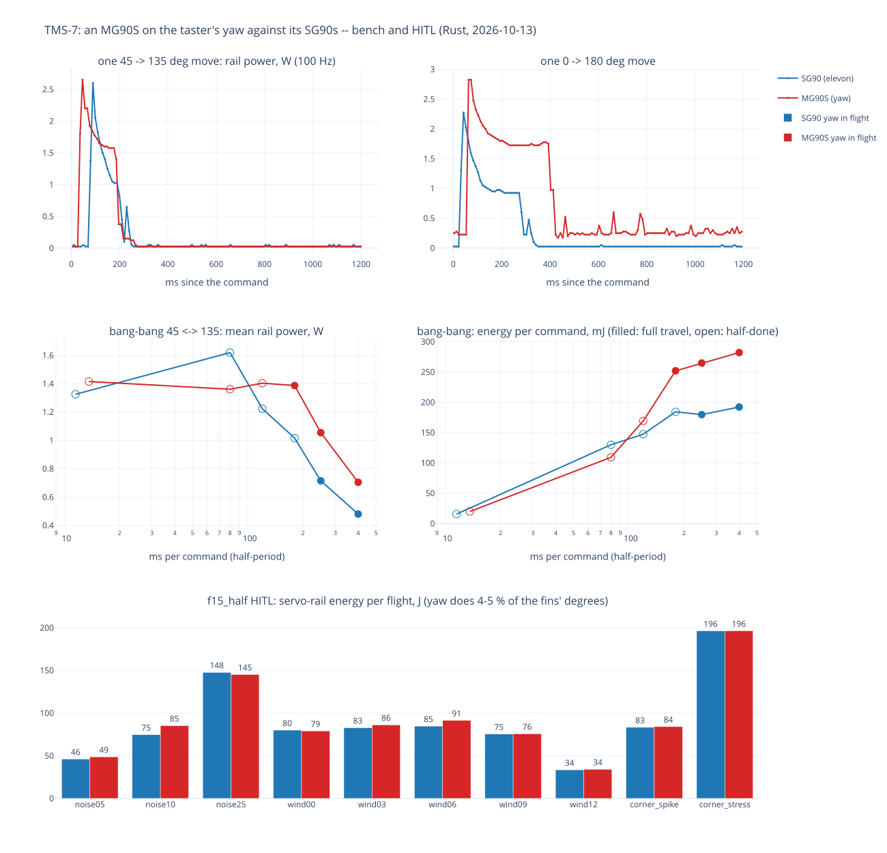

# TMS-7 — an MG90S on the yaw: what changes against the SG90, and against plan B's measurement

**What it asks** (the operator, 2026-10-13, with a positional metal-gear MG90S fitted to the taster's yaw): what
differs between the SG90 and the MG90S, and how that compares with the Python-controlled case; then the fin driven
between its limits (−45/+45 about the 90-degree neutral, from the config) as fast as it will go.

**The rig.** The taster (board v1.1, Rust `33b188d`), `servo_yaw` = MG90S (`driver: mg90s`) on GPIO26, the two
elevons SG90s; the servo rail through the INA226, read every 10 ms for the bench (4-sample average of 1.1 ms
conversions: ~100 Hz, plan B's setting) and every 100 ms in flight (the run it is compared with). One servo moves at
a time, `fins.concurrency` 1. The rail comes from the bench supply: 4.92 V at rest, ~4.3 V at 0.64 A, 3.8 V at 0.82 A
(about 1 Ω of source). The comparison servo is the left elevon's SG90.

## 1. The bench: one move at a time (`bench_moves.csv`)

10 moves each way, 1.2 s apart, from the 100 Hz rail; medians, the first cycle dropped.

| | SG90 | MG90S | MG90S / SG90 | plan B's MG90S (2026-07-25, hardware.md) |
|---|---|---|---|---|
| energy per ±45 move (45 ↔ 135) | 200 mJ | 295 mJ | **1.46** | — |
| energy per 180-degree sweep | 320 mJ | 566 mJ | 1.77 | 625 mJ |
| peak from rest | 2.6 W / 0.61 A | 2.7 W / 0.64 A | ~1.05 | 3.9 W / 0.79 A |
| holding inside 45..135 | 25 mW (the whole rail) | 25 mW | 1 | 41 mW |
| holding at 0 and 180 | 25 mW | **225-250 mW: stalled** | — | — |

- **The MG90S stalls at its mechanical ends.** Held at 0 degrees, or at 170 and up, it draws 175-250 mW and stays
  there; it is stall-free from 5 to 165. The SG90 holds 25 mW all the way to 0 and 180. Flight (45..135), the probe
  (45/135/90) and the failsafe never go there; only a manual full-travel `update` does.
- **Where the MG90S's extra energy goes:** it keeps drawing ~1.6-1.75 W through the move, where the SG90's draw falls
  away after the start (the figure's top row): the metal gear train's friction. The start peak is the same motor's.

## 2. Bang-bang: −45/+45 as fast as it goes (`bang_bang_bursts.json`)

20 commands per burst at a fixed pace; the operator watched each burst (full travel, or "half-done": the servo
reverses before it arrives).

| ms per command | SG90: travel | SG90: mean W, mJ/command | MG90S: travel | MG90S: mean W, mJ/command |
|---|---|---|---|---|
| 400 | full | 0.48, 192 | full | 0.70, 282 |
| 250 | full | 0.72, 180 | full | 1.05, 265 |
| 180 | half-done | 1.02, 184 | **full** | 1.39, 252 |
| 120 | half-done | 1.22, 147 | half-done | 1.40, 169 |
| 80 | half-done | 1.62, 130 | half-done | 1.36, 109 |
| ~12 (back-to-back) | half-done | 1.32, 16 | half-done | 1.42, 20 |

- **The MG90S is the faster one:** a full 90 degrees within 180 ms, where the SG90 needs between 180 and 250 ms. That
  bears out the firmware's type defaults (MG90S 100, SG90 150 ms per 60 degrees, crates/drivers). The time a servo
  draws current is not its travel time: the MG90S draws longer and still arrives first.
- **Reversing in motion draws more than starting from rest:** the SG90 peaks at 3.15 W / 815 mA and the MG90S at
  3.0 W / 763 mA, and the rail sags to 3.8 V. plan B sized the flight rail on start-from-rest sweeps (3 × 0.79 A =
  2.4 A against the ND3A05SD's 3 A); three fins reversing together on that stiff 5 V rail would go higher.
- **Commands faster than the 20 ms PWM frame** (the back-to-back burst, ~12 ms) make both servos hunt in place:
  ~1.4 W with almost no travel.

## 3. In flight: the f15_half preflight with the MG90S yaw (`flights.csv`)

The ten f15_half scenarios (F15, 235 g) flown again on the taster with the MG90S yaw, against the same flights with
the SG90 yaw ([TMS-7-preflight_rust](../TMS-7-preflight_rust/) r1, earlier the same day). 10 of 10 to DONE.

- **The servo rail's energy per flight barely moves: MG90S / SG90 median 1.014 (0.98-1.14).** The yaw does only
  **4-7 % of the fins' degrees** in flight (noise05: 813 degrees of yaw against 10,776 of elevons); the elevons do the
  rest. +46 % on 5 % of the degrees is ~+2 %.
- **Peaks:** 851-931 mA with the MG90S, 824-904 mA with the SG90, plan B's three runs 756-1013 mA.
- **The landing is the HITL's, not the servo's:** 6 of 10 in the zone (median 49.7 m) against 7 of 10 (44.0 m); wind03
  moved out (45 → 66 m). The host physics takes the commanded angles, and both servo types are commanded the same, so
  the servo type cannot move the landing; a single scenario needs ~30 m before it means anything
  ([TMS-7-preflight](../TMS-7-preflight/)).
- **What the MG90S would cost on all three fins** (the TMS-8 draft carries three): the +46 % then applies to ~all the
  degrees, about +45 % of the rail's energy per flight (34-196 J → ~50-285 J here).

## 4. Against the Python-controlled case

The control path is the same: Rust's servo logic is plan B's (`drivers/sg90.py`, `mg90s.py`), checked byte for byte
by `crates/drivers/tests/golden_servo.rs`, and both drive the same 50 Hz, 500-2500 µs pulses. What differs is the rig.

- **Energy per 180-degree sweep agrees within 9 %** (566 mJ against plan B's 625 mJ).
- **The lower peak is the supply:** plan B measured on the airframe's ND3A05SD converter, a stiff 5 V rail; the
  taster's bench rail sags to ~4.3 V at 0.64 A. 0.64 A scaled to 5 V is ~0.74 A, against plan B's 0.79 A.
- **plan B never measured** the stall at the ends, the reversal peaks, or the fast-reversal limit; its "41 mW
  holding" sits between this rig's 25 mW inside the travel and the 225-250 mW at an end.

## Files

- `mg90s_vs_sg90.html` / `.svg`: the figure (bench moves, bang-bang, flight energy per scenario).
- `bench_moves.csv`: every bench move (servo, test, cycle, angle, peak, energy above the holding level, holding).
- `bang_bang_bursts.json`: each burst's servo, pace and board-uptime window (the 100 Hz rail stream stays local).
- `flights.csv`: per scenario, plan B's peak range, and for each yaw servo the rail's energy and peaks and each fin's
  moves and degrees.
