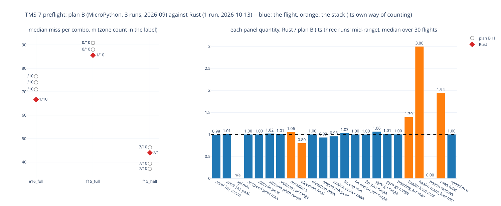

# TMS-7 — the preflight again, on Rust: plan B against the Rust board, combo by combo

**What it asks** (the operator, 2026-10-13): fly the Python preflight ([TMS-7-preflight](../TMS-7-preflight/): plan B
on the board, 90 flights in September) with the Rust firmware, and compare results and charts.

**How it was flown.** The taster (Rust `15cb17f`, realtime HITL, its SG90s on the INA226 rail) flew plan B's three
combos over the same ten scenarios: `e16_full` (E16, 285 g), `f15_full` (F15, 285 g), `f15_half` (F15, 235 g). One run,
30 flights, all to DONE (`tools/hitl_matrix_host.sh`). The firmware's defaults of the day ride along: the 3-degree fin
grid, the endgame's turn kept across the heading wrap; plan B wrote every fin change and took the shortest turn.

The charts are plan B's, under its file names: `r1/<combo>_report_<scenario>.svg` (the ground track with the zone,
the altitude and roll), `r1/<combo>_compare_{noise,wind}.svg` (the overlays), and the interactive 11-panel
`flight_report` for noise05 and corner_stress per combo (`r1/<combo>_report_<scenario>.html`). plan B's tools read a
Rust flight cut since `052c27f`, so the same code draws both. `panels.json` holds every one of hitl_compare's 23
panel quantities per flight against plan B's three-run range (`doc/sims/TMS-7-preflight/comparison.json`), reduced
by the same code; `comparison.json` is the Rust run's own.

## The landing: the same, down to which scenarios land

| combo | plan B: median miss, r1 / r2 / r3; in the zone | Rust: median miss; in the zone |
|---|---|---|
| `e16_full` | 74.0 / 71.0 / 76.6 m; 1 of 10 each run | **66.7 m; 1 of 10** |
| `f15_full` | 90.9 / 90.8 / 88.0 m; 0 of 10 each run | **85.6 m; 1 of 10** |
| `f15_half` | 39.3 / 46.3 / 37.1 m; 7 of 10, the same seven every run | **44.0 m; 7 of 10, the same seven** |

- **`f15_half` lands in the zone in the same seven scenarios** as all three of plan B's runs: noise05, noise10,
  noise25, wind00, wind03, wind06, corner_spike. wind09, wind12 and corner_stress stay out on both. That reproduces a
  verdict per scenario, which plan B's study called the stronger result than a matching median.
- The full-mass combos land 5-8 m closer than plan B's medians, within plan B's own bar for a single run (its study:
  a scenario needs ~30 m to mean anything, the median ~6 m): the wrap latch's direction, not a measured gain.
- **f15_half is still the combo to fly** on TMS-7.

## The panels: the flight agrees, the stack differs as it should

Per panel quantity, Rust over the middle of plan B's three-run range, the median over the 30 flights:

| | quantity | Rust / plan B | inside plan B's range (of 30) |
|---|---|---|---|
| **flight** | airspeed (pitot) max | 1.00 | 30 |
| | fin eleron_left / yaw range | 1.00 / 1.00 | 30 / 29 |
| | heading error max | 1.00 | 20 |
| | fin cap min | 1.03 | 23 |
| | altitude / elevation peak | 1.00 / 1.00 | 17 / 16 |
| | GNSS speed max | 1.00 | 8 |
| | attitude roll / pitch range | 1.01 / 1.02 | 7 / 13 |
| | gyro gx / gz range | 1.06 / 1.01 | 12 / 14 |
| | accel peak / mean | 1.01 / 0.99 | 15 / 10 |
| | servo rail peak mA / power | 0.93 / 0.96 | 6 / 8 |
| **stack** | heap free, lowest | **3.00** | 0 |
| | rescues | **0** | 9 |
| | load max | 1.39 | 0 |
| | rows recorded | 1.94 | 0 |
| | flight duration | 1.06 | 0 |

- **Every flight quantity sits at 1.00 ± 0.06 of plan B's.** A count under 30 inside the range is the narrowness of
  three runs, not a drift: the ratios are where they are.
- **The servo rail peaks 4-7 % lower:** the 3-degree grid (half the moves, doc/sims/TMS-7-servo_step).
- **The stack is where the two differ, by design:** the Rust heap stays flat (3x plan B's lowest free; plan B's
  garbage collector sawed it) and needs no rescue collection; Rust records about twice the rows (more streams, its
  own rates); its load is the busiest core with the recorder's threads in it (plan B's was its one interpreter
  thread); a Rust cut also keeps more of the pad. `agl min` is not compared: the Rust cut's laser reads nothing in
  range on these flights.

## Caveats

- **Two simulators.** Plan B flew its physics on the board (`tasks/hitl.py`, MicroPython) in September; the Rust board
  takes its frames from the host's `sim_model.py` (`tools/hitl_host.py`), after the October physics fixes. The SITL
  reproduces plan B's board numbers at the median (TMS-8-preflight: 42.3 m against 37-46 m at 235 g), and the flight
  panels agree at 1.00; a difference below ~6 m in a median is not resolved here.
- **One Rust run** against plan B's three: plan B's runs give the spread.
- **Rust's defaults differ on purpose** (the fin grid, the wrap latch); `step_deg: 1` and `turn_wrap_band_deg: 0` fly
  plan B's behaviour if a strict A/B is ever needed.
