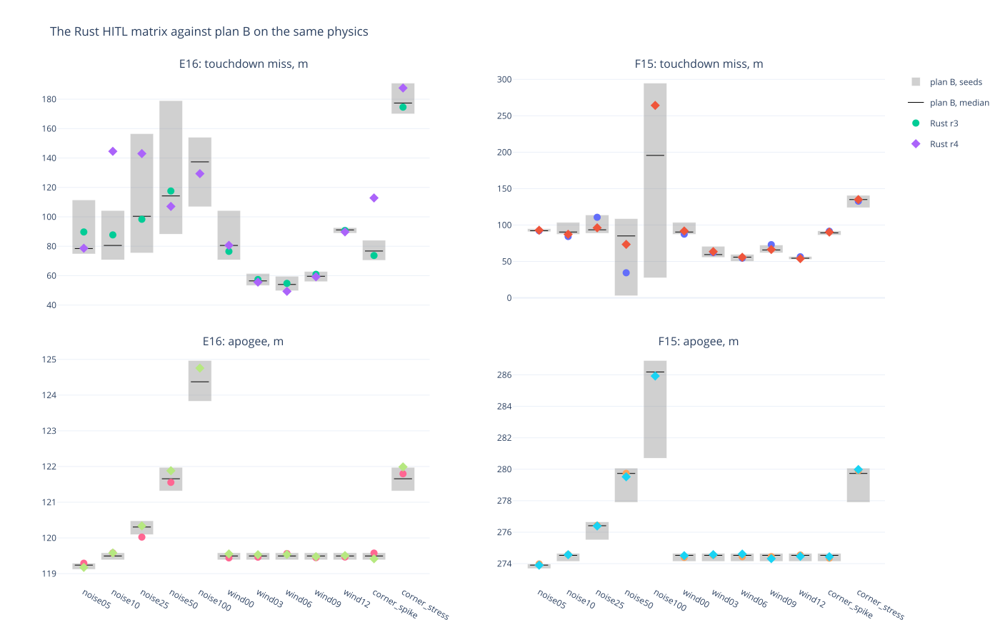

# TMS-7 — the Rust board against plan B, the whole matrix (M14)

**The Rust flight firmware flies the 12-scenario HITL matrix (noise, wind, corners) × {E16, F15} like plan B.** The
comparison runs both stacks on the same frames: the Rust board on the taster (`tools/hitl_matrix_host.sh`), the Rust
SITL (`src/avionics/sitl`) and plan B's own flight code (`tools/planb_sitl.py`). All three sit behind one harness,
`tools/hitl_host.py` on `src/glider/sim_model.py`, and `tools/hitl_matrix_compare.py` judges them.

All flights: 285 g glider, the HPRC pad and zone, plan B's HITL test gains, the scenario table of `hitl_matrix.sh`.

## 1. The reference had to be plan B's own code

The first reference was `tools/virtual_flight.py`, and against it the Rust stack looked 10–20 m worse in the wind.
That was the harness, not the port. virtual_flight's loop:

- feeds **no wind estimator** ("this loop feeds no wind estimator");
- hands its law the GNSS **total speed, unnoised**, where plan B's own on-board HITL (`tasks/hitl.py`) publishes the
  noised horizontal ground speed and track;
- noises the barometer at the full `--noise`, where `tasks/hitl.py` scales it ×0.05. With that model it detected
  apogee early under noise, 100 m below the true one.

So it was never plan B's full stack. `tools/planb_sitl.py` is: plan B's Controller, `tasks/sequencer.py` and
`tasks/flight.py` under the golden shims, behind the same sim-link, lockstep. Fed the same frames, the two stacks
fly the same flight:

| F15, 285 g | miss | GLIDING | LANDING | fin travel |
|---|---|---|---|---|
| clean, Rust SITL | 41.6 m | 10.16 s | 108.9 s | 29.2 deg/s |
| clean, plan B SITL | 41.6 m | 10.16 s | 108.9 s | 28.9 deg/s |
| wind 6 m/s, the Rust board (HITL, M13) | 37.3 m | 10.10 s | 108.6 s | 27.8 deg/s |
| wind 6 m/s, Rust SITL | 37.4 m | 10.16 s | 108.5 s | 27.7 deg/s |
| wind 6 m/s, plan B SITL | 37.4 m | 10.16 s | 108.5 s | 27.9 deg/s |

## 2. The SITL matrix: 72 Rust flights, all inside plan B's

Three seeds per scenario (`hitl_host --seed`) on both SITLs. A seed's frames are the same for both stacks while
their flights agree. Gates: the apogee (3 %), GLIDING (0.5 s) and DONE on every scenario; the miss on the wind and
low-noise families, widened by the post-audit board matrix's run-to-run spread (7.7 m, 11.9 m).

**72 of 72 pass** ([table](sitl_vs_planb.md)). Seed for seed:

| family | pairs | miss difference, median / max | GLIDING difference, max |
|---|---|---|---|
| wind 00–12 | 30 | 1.0 / 7.6 m | 0.00 s |
| low noise 05–25 | 18 | 0.3 / 8.6 m | 0.00 s |
| corner spike/stress | 12 | 1.1 / 8.0 m | 0.00 s |
| high noise 50–100 | 12 | 9.9 / 118.6 m | 0.00 s |

The stage machine never differs. The misses fork only at high noise, where a one-degree rounding difference in a fin
sends the flights onto different tracks, which then meet different noise. The post-audit study measured that
family's run-to-run spread at 80–150 m on plan B alone.

All 144 lockstep flights (both stacks) took about 30 s on the host: a regression matrix for any law change, no board.

## 3. The board matrix: 24 flights on the taster, realtime

`tools/hitl_matrix_host.sh`, run r1. **23 of 24 pass** against plan B's seeds ([table](board_r1_vs_planb.md)).
Per scenario, the miss from the zone centre (m):

| motor | scenario | board r1 | Rust SITL s1/s2/s3 | plan B SITL s1/s2/s3 |
|---|---|---|---|---|
| E16 | noise05 | 76.7 | 78 / 79 / 75 | 78 / 79 / 75 |
| E16 | noise10 | 73.7 | 76 / 82 / 82 | 75 / 82 / 80 |
| E16 | noise25 | 78.6 | 113 / 116 / 76 | 122 / 116 / 74 |
| E16 | wind03 | 69.7 | 57 / 62 / 65 | 57 / 65 / 65 |
| E16 | wind06 | 53.6 | 57 / 52 / 55 | 53 / 49 / 54 |
| E16 | wind12 | 91.7 | 92 / 91 / 90 | 91 / 90 / 90 |
| F15 | noise05 | 92.5 | 92 / 93 / 91 | 92 / 93 / 91 |
| F15 | wind06 | 54.1 | 57 / 59 / 52 | 58 / 51 / 53 |
| F15 | wind09 | 65.2 | 66 / 73 / 62 | 72 / 74 / 62 |
| F15 | wind12 | 57.0 | 56 / 55 / 55 | 57 / 56 / 54 |
| F15 | corner_stress | 130.1 | 127 / 137 / 140 | 126 / 129 / 134 |

(the full 24 rows in the table file; chart: [`f15_wind06_board_vs_planb.html`](f15_wind06_board_vs_planb.html),
[SVG](f15_wind06_board_vs_planb.svg))

- **The one failure:** E16 corner_stress (noise 50 %, wind 12 m/s, spikes) detected apogee 0.9 s early on the board
  (GLIDING 5.6 s; plan B's seeds 6.5–6.9 s). Flown three more times, it gave 6.70, 6.75 and 6.50 s, all inside.
  Neither SITL did it in 10 seeds (both 6.2–6.8 s, the same per seed). It was one realtime flight's noise, in the
  family the spec does not gate.
- **No noisy flight lands in the zone, on either stack.** With noise at 5 % or more every miss is 50–100 m; clean,
  both land at ~40 m inside. This is plan B's behaviour on today's sim, reproduced, not something the port changed.

## 3b. The second board run (r2, 2026-10-12): the board's own run-to-run spread

The same firmware build and harness as r1, a day later. One flight (F15 noise10) was refused at the arm: the taster's
INA226 did not answer at that boot. It flew on the next boot. All 24 reached DONE.

Against plan B's three seeds, r2 failed two gates. Both outliers come from plan B's own spread, which three seeds do
not cover. Flown with 20 seeds, plan B gives a wider range, and **r2 passes all 24**. Table:
[`board_r1_r2_vs_planb20.md`](board_r1_r2_vs_planb20.md).

| scenario | r2 | plan B, 3 seeds | plan B, 20 seeds |
|---|---|---|---|
| E16 noise25, the miss | 156.3 m | 74.1..121.5 m | 72.4..188.6 m |
| F15 noise100, GLIDING | 7.8 s | 8.8..10.5 s | 7.5..10.5 s |

r1's one failure (E16 corner_stress, GLIDING 5.6 s) stays just outside the 20 seeds too (6.2..6.9 s, gate 0.5 s). Its
three re-flights and r2 (6.5 s) were inside.

r1 against r2, the same scenario flown twice on the board:

| family | pairs | miss difference, median / max | GLIDING difference, max |
|---|---|---|---|
| wind 00-12 | 10 | 2.7 / 9.8 m | 0.10 s |
| low noise 05-25 | 6 | 2.5 / 77.7 m (E16 noise25) | 0.15 s |
| corner spike/stress | 4 | 0.6 / 3.2 m | 0.80 s |
| high noise 50-100 | 4 | 11.0 / 143.3 m (F15 noise100) | 1.45 s |

The wind family repeats within ~10 m. This sits next to the 7.7 m median the miss gate takes from the post-audit
board study. noise25 forks the way plan B's seeds fork. The stage machine repeats within 0.15 s outside the
high-noise and corner families.

## 3c. The drops on the SITLs, and the sim's IMU frames (2026-10-12)

The lockstep SITLs now fly the realtime matrix's drops: the attitude gone 3 s into the glide, or the GNSS out for
5 s from 2-6 s in. First the sim's IMU frames had to match a board's. The sim published the rate as (roll, pitch,
yaw) and the glide's accel on one axis. The IMU drivers publish both in the marks frame (x forward, y left, z up),
and the law and the filter read them so (`rate_from_marks`). Now the sim publishes the rate as (roll, -pitch, -yaw)
and the glide's specific force as (sin pitch, 0, n cos pitch). `tools/planb_sitl.py` maps the rate back to plan B's
channel. The airspeed estimator integrates |a| - g, so the accel's change moves it only in a bank.

- **Both stacks on the new frames, 72 + 72 flights:** 72 of 72 pass. Seed for seed the misses agree within 0.7 m
  (wind) and 0.8 m (low noise) median, and GLIDING to the hundredth. The frames moved plan B's own misses by 2.7-3.2 m
  median (the bank's load), so later board runs compare against a reference flown on these frames.
- **The attitude drop** (noise 10 %, no wind, seeds 1-3): the Rust filter carries the glide. F15 lands 28 / 95 / 87 m
  from the centre against 92 / 90 / 89 m without the drop; E16 lands 71 / 75 / 99 m against 84 / 74 / 77 m. Before the
  frames it landed ~500 m off. Plan B's SITL has no reference here: it runs no attitude filter, so after the drop its
  law flies a frozen attitude (219-405 m off).
- **The GNSS drop:** the two stacks agree within 13 m (F15 70-87 m Rust, 77-86 m plan B; E16 95-110 m and 94-107 m).

- **On the board** (the taster, realtime, the firmware whose law reads the marks-frame rate): F15 noise10 lands
  101.2 m from the centre, inside plan B's 20 seeds on the new frames (87.2-103.6 m). The attitude drop lands 92.4 m:
  the board's filter carries the glide as the SITL's does (`HOST_FLAGS="--attitude-drop-s 3"
  tools/hitl_collect_host.sh ...`).

The reboot stays realtime-only: it needs a warm start, which the SITL does not have.

## 3d. The third board run (r3, 2026-10-12): the new frames and the day's firmware

The taster flew the matrix on the frames of §3c and the firmware of the day: the law reading the marks-frame rate,
the BNO055 and BMP280, the SD bounce fix, the INA226 alert, the warm-start cap and grounds. The reference is plan B's
SITL on the same frames, 20 seeds. Table: [`board_r3_vs_planb20_newframes.md`](board_r3_vs_planb20_newframes.md).

- 22 of 24 flew and passed every gate.
- The two noise100 flights never flew: both launched falsely on the pad, |a| 2.5 and 2.7 g held 100 ms, while the
  arm's probe sweep still ran. At 100 % noise the pad's |a| is uniform from -1 to 3 g, so the dwell can fill by
  chance, and the arm then finds the board in BOOSTING. r1 and r2 got through those seconds; replayed through the
  dwell rule, their pads could have fired too.
- Flown twice more each, all four noise100 flights armed and passed (F15 216 and 224 m against plan B's 28-295 m;
  E16 130 and 121 m against 107-154 m; GLIDING inside).

So 26 of 26 flights flown on the new frames pass. The noise100 pad keeps a false-launch risk that is the
scenario's own, not the board's.

## 3e. The SITL on the board's control tick (R3, 2026-10-12)

The refactor's R3 (doc/specs/avionics-refactor.md) moved the control tick's duties (the attitude filter, the stage
machine, the flight law) into crates/controller `ControlCore`, and the SITL now runs it instead of its own copies.

The copies differed in one place: the stage machine's pacing. With the config's 50 ms step on the 10 ms tick:
- the board's control thread steps within half a tick of slack, at 0, 40, 90, 140 ms;
- the old SITL stepped at 0, 30, 80, 130 ms, a phase no board runs. It is plan B's SITL's phase too
  (`tools/planb_sitl.py` paces with the same `max(due + period, now + period / 2)`), which is why §2 found the two
  stage machines never apart.

The extraction is exact otherwise. Proof: the old SITL with only the board's pacing formula patched in flies the
same 72 flights as the new SITL, every figure identical.

On the board's phase, against plan B's 20 seeds on the new frames (§3c):

| seeds | old SITL | the board's tick |
|---|---|---|
| 3 (72 flights) | 0 gate failures | 1 |
| 10 (240 flights) | 0 | 3 |

- The wind and low-noise families stay within a few metres of before, and every apogee is identical.
- The GLIDING times move by the 20 ms of the new phase.
- The three failures sit in the noisiest families:
  - E16 noise25 seed 3, 182 m against plan B's 75–157 m;
  - F15 noise25 seed 10, 161 m against 89–114 m;
  - E16 noise100 seed 9, GLIDING at 8.3 s against 5.8–7.3 s.

There, a 10 ms shift in when the stage machine looks changes the boost and apogee detections by a step, and the
endgame's orbit phase does the rest (the same lottery as §2's high-noise forks).

The board ran this phase all along: the realtime matrices of §3–§3d are the board's code. The SITL now grades
that code, not a near copy. Open: plan B's reference still steps on the old phase. Moving `planb_sitl.py` to the
board's pacing would compare the two laws on one stage-machine phase, and the 20-seed reference would be flown again.

## 3f. The fourth board run (r4, 2026-10-13): the refactored firmware, the RAM fix

The taster flew the matrix on firmware `60687fa`: the refactor's R1–R5 (doc/specs/avionics-refactor.md, the board's
control tick in crates/controller, the boxed `ControlCore`), and the internal-RAM fix (the ring's threads and
esp_hosted on PSRAM stacks: idle internal RAM 40 -> 137 KB). The reference is plan B's SITL, 20 seeds on the new
frames. Table: [`board_r3_r4_vs_planb20.md`](board_r3_r4_vs_planb20.md); per motor, each run's miss and apogee against
plan B's seed range: [`board_r3_r4_vs_planb20.html`](board_r3_r4_vs_planb20.html)
([SVG](board_r3_r4_vs_planb20.svg)).

- **24 of 24 reached DONE; 23 pass every gate.** The noise100 pads that launched falsely in r3 armed and flew.
- r3 against r4, the same scenario on two firmware builds:

  | family | pairs | miss difference, median / max | GLIDING difference, max |
  |---|---|---|---|
  | wind 00-12 | 10 | 2.2 / 6.7 m | 0.05 s |
  | low noise 05-25 | 6 | 12.8 / 56.8 m (E16 noise10) | 0.05 s |
  | corner spike/stress | 4 | 7.6 / 39.1 m | 0.50 s |
  | high noise 50-100 | 2 | 24.7 / 39.0 m | 0.50 s |

  The wind family repeats as r1 against r2 did (§3b): the refactor and the RAM work changed nothing the law sees.

- **The one failure, E16 noise10, 144.6 m** (plan B's 20 seeds 70.8–104.3 m). Its twin, wind00, flies the same noise
  with no wind and landed at 80.6 m. Both reached the endgame's orbit with the heading error near 180 degrees. There
  the twin kept turning left (heading error -167 -> -49 degrees). The failing flight's noise flipped the turn across
  the wrap:

  | t, s | heading error | roll setpoint | turn |
  |---|---|---|---|
  | 35.3 | +179 deg | +54 deg | right |
  | 37.4 | -178 deg | -59 deg | left |
  | 39.5 | +154 deg | +54 deg | right |

  It then committed to the right with 121 degrees still to turn, and came down 145 m out. Ground tracks:
  [`e16_noise10_vs_wind00_r4.html`](e16_noise10_vs_wind00_r4.html) ([SVG](e16_noise10_vs_wind00_r4.svg)).
  This is the law's, shared by both stacks: plan B's own 20 seeds reach 156.6 m at noise25, and the Rust SITL's
  reach 184.3 m there. A realtime board, with its timing jitter on top of the nominal noise, met it at noise10.
  It is not a port defect. §3g fixes it in the law.

## 3g. The turn kept across the wrap (`turn_wrap_band_deg`, 2026-10-13)

The operator asked for the fix §3f found (`3bff106`). When the last heading error and the new one both lie within
the band of 180 degrees on opposite sides of the wrap, the steering keeps the turn in progress, reported as ±180.
Continuing the turn carries the raw error across the wrap within the band. A target that really moved across, such
as the oval's leg ends (this zone is a 186 x 40 m strip, so the Mission flies the oval), costs at most twice the band
of extra turn. A band of 0 is plan B's law, and the golden fixtures replay there.

Flown over the Rust SITL with plan B's law (band 0) as the reference, 8 scenarios × 20 seeds per motor, seed for
seed:

| band | F15 mean / worst miss | F15 in zone | E16 mean / worst miss | E16 in zone |
|---|---|---|---|---|
| 0 (plan B) | 88.8 / 294.9 m | 11 of 160 | 88.5 / 197.1 m | 11 of 160 |
| 15 | 95.9 / 458.8 m | 17 | 82.4 / 192.5 m | 17 |
| 30 | 91.3 / 321.5 m | 13 | 78.9 / 156.2 m | 18 |
| **45 (the default)** | **78.5 / 148.3 m** | **18** | **78.3 / 149.2 m** | **18** |
| 60 | 78.6 / 166.1 m | 16 | 79.1 / 148.4 m | 17 |

15 degrees is too narrow: noise still crosses it. 45 and 60 land alike, and 45 has the shorter tail. Per scenario,
at 45 against plan B's law:

- **The low-noise tail is gone.** E16 noise25's worst goes from 184 to 90 m (median 107 -> 80 m), and noise10's from
  103 to 77 m. That is §3f's failure, removed.
- **wind03 lands in the zone more:** F15 2 -> 10 of 20, E16 11 -> 17.
- **F15 noise100's median goes from 190 to 55 m** (in the zone 3 -> 8).
- **wind06 and wind09 are identical seed for seed**: nothing flips there.
- **One loss: F15 noise50**, median 94 -> 110 m, in the zone 6 -> 0. Plan B's flip-flop dithered the oval there, and
  six seeds touched down mid-strip by chance. A recorded seed (4) shows it: both fly the same ±150 m racetrack, and
  plan B's touches down at 7 m from the centre, the latch's at the west end, 107 m. With the latch, noise50 flies
  as the low-noise flights do: none of F15's noise05-25 flights lands in the zone either way. That is the oval's
  orbit-phase lottery, not the latch.

The regression gate (`hitl_matrix_compare.py sitl` and `compare`, 72 flights, 3 seeds, against plan B's 20 seeds):
71 pass. The one outside is E16 wind03 seed 1, which lands **19.3 m from the centre, in the zone**, below plan B's
53.4–61.5 m. The gate is two-sided, so a law that now differs from plan B's on purpose fails it only by landing
better. Table: [`latch_sitl_vs_planb20.md`](latch_sitl_vs_planb20.md).

## 4. What it took

- `tools/hitl_matrix_host.sh`: the matrix for a Rust board, the scenario table of `hitl_matrix.sh` (a test keeps the
  three tables equal), the artefacts counted.
- `tools/hitl_matrix_compare.py`: `reference` (plan B's SITL), `sitl` (the Rust SITL), `compare` (any runs against
  the reference's seeds, the family gates).
- `src/avionics/sitl` and the firmware share their plumbing (crates/controller: the topology, `HitlWriters`,
  `StageSources`, `FlightQuantities`). The board refactored onto it flies as before: F15 clean 38.7 m in the zone.
- `tools/hitl_host.py --sitl`: lockstep, seeded, `--record`ed; `tools/sim_link_codec.py` holds both ends of the
  frames (a process under the shims cannot import the hub's transports).
- `tools/recorder_flight.py` anchors a cut on the stage machine's BOOSTING row when no |a| holds 3 g (a HITL boost is
  the sim's ~3 g; under noise six flights of r1 found no boost to cut at).
