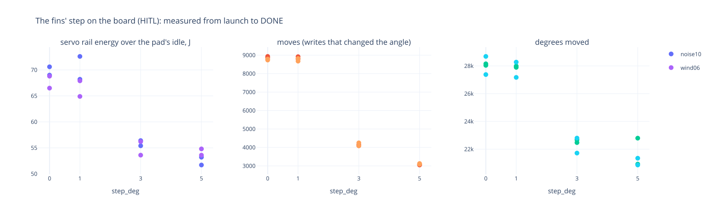
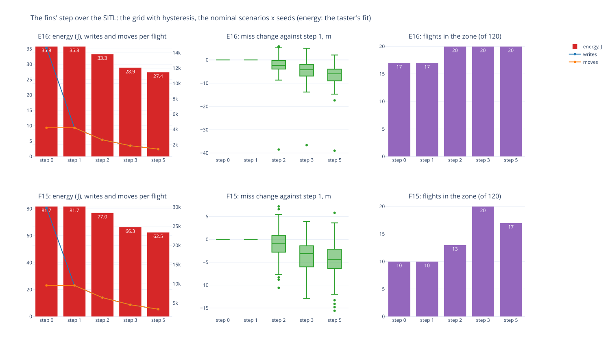

# TMS-7 — the fins' step: energy, moves and the landing (`step_deg` 0 / 1 / 2 / 3 / 5)

**What it asks** (the operator, 2026-10-13). A fin need not chase every degree the law asks for. A 45-degree throw
in 3-degree steps is 15 positions; in 5-degree steps about the neutral it is 9 down, 9 up and the centre, 19 in all.
Is that good enough? What do 0 (every command written), 1 (plan B's any change), 3 and 5 cost in energy, in moves
(how many, how far), and in accuracy?

**The answer: a 3-degree grid, now every servo's default** (`69a4496`). On the taster's SG90s it writes half the
moves of step 1 and draws ~20 % less servo energy, and it lands no worse, in the SITL a few metres better. If
anything goes wrong, `step_deg: 1` on the servo entries is plan B's any-change again, a config change with no
reflash.

**What the step is** (`step_deg`, a fin entry's setting; crates/drivers sg90 `Servo::set_angle`, `4fae0dc`). Over 1,
a fin stands on a grid of that many degrees about its neutral, and leaves a grid point only once the command is more
than half a step and a degree away. 1 writes any change (plan B's compare-and-set), and 0 writes every command, an
unchanged one too.

**How it was flown.**
- **The board:** the taster, realtime HITL, its three SG90s on the INA226-metered rail. F15 noise10 and wind06 at
  steps 0 / 1 / 3 / 5, two runs each, interleaved: 16 flights (`tools/hitl_collect_host.sh` with
  `HOST_FLAGS="--servo-step N"`, tallied by `tools/servo_step_sweep.py board`). From the launch to DONE: each fin's
  writes, its moves (writes that changed the angle) and its degrees, and the rail's energy over the pad's idle draw.
  Then 8 more flights of the first cut, a deadband (below), at steps 3 and 5.
- **The SITL:** the Rust flight code lockstep on `tools/hitl_host.py`, driving the board's own servo code
  (`1100c22`), so the physics flies the angles the fins hold. 2 motors × 8 scenarios × 20 seeds × 5 steps = **1,600
  flights** (`tools/servo_step_sweep.py sitl`, the taster's config, HEAD's law with the wrap latch). The SITL has no
  power rail: its energy is the board's model, 2.46 mJ per degree commanded.

Data (';'): `board.csv`, `board_deadband.csv`, `sitl_runs.csv`, `sitl_summary.csv`, `variants.csv`. Figures:
`board.html` / `board.svg` (the taster), `steps.html` / `steps.svg` (the SITL).

## On the board (F15, mean of noise10 and wind06, two runs each)

| step | writes | moves | degrees | energy | miss noise10 (r1, r2) | miss wind06 (r1, r2) |
|---|---|---|---|---|---|---|
| 0 | 29,490 | 8,831 | 28,065 | 68.7 J | 90.9, 89.5 m | 56.3, 50.8 m |
| 1 (plan B) | 8,802 | 8,802 | 27,834 | 68.4 J | 89.5, 88.6 m | 55.5, 52.0 m |
| **3 (the default)** | 4,143 | **4,143** | 22,419 | **55.4 J (-19 %)** | 85.7, 88.5 m | 51.9, 45.8 m |
| 5 | 3,083 | 3,083 | 21,482 | 53.3 J (-22 %) | 89.3, 84.8 m | 53.7, 46.5 m |

- **The energy follows the degrees commanded, not the moves.** Over the 16 flights it fits 2.46 mJ per degree,
  every flight within 4 J, and nothing measurable per move. Step 0 shows it outright: 29.5 k writes against step
  1's 8.8 k, and the same energy, because a rewrite of a held angle moves nothing.
- **Steps 3 and 5 halve or third the moves and cut ~20 % of the energy.** The degrees fall less than the moves: a
  coarser fin makes fewer, larger moves.
- **The spikes get rarer, not smaller.** The INA226 reads a 9 ms average every 100 ms, so it samples the rail.
  The time above 1 W falls from 29-33 % of the flight (steps 0/1) to 22-25 % (3/5), above 2 W from 6.8-8.7 % to
  5.5-7.2 %. The largest sample stays ~3.3 W / 850 mA: any real move still draws a full start. The starts (moves)
  fall 2-3x.
- **The landing:** two flights per cell cannot resolve a few metres (a single flight scatters ~10 m). Steps 3 and 5
  land as step 1 or a little better, as the SITL predicts.

## Over the SITL (the six nominal scenarios × 20 seeds per motor)

| step | F15 moves | F15 energy | F15 miss change, median (p90) | F15 in zone | E16 energy | E16 miss change | E16 in zone |
|---|---|---|---|---|---|---|---|
| 0 / 1 | 9,572 | 81.7 J | — | 10 of 120 | 35.8 J | — | 17 of 120 |
| 2 | 6,402 | 77.0 J | -0.9 (+2.2) m | 13 | 33.3 J | -2.3 (+1.9) m | 20 |
| **3** | 4,544 | **66.3 J (-19 %)** | **-3.1 (+0.8) m** | **20** | **28.9 J (-19 %)** | **-4.2 (+1.2) m** | **20** |
| 5 | 3,380 | 62.5 J (-23 %) | -4.3 (-0.3) m | 17 | 27.4 J (-23 %) | -6.0 (-2.1) m | 20 |

The miss change is each seed's against the same seed at step 1. The SITL's energy reduction matches the board's
(-19 % at step 3 both ways), so its model carries over. The landing gets slightly better, not worse, with the step.
The fin chatter of step 1 turns noise into attitude jitter, and sim_model's sink costs are convex: the bank's load
factor costs n^1.5, and an off-trim pitch costs its absolute value. Fewer, firmer fin positions waste less height.
The size of that gain is the model's; its direction holds for any airframe whose sink grows with bank and off-trim
pitch.

## A deadband first, then the grid

The first cut (`aec23d9`) was a deadband: write once the command is a step from the held angle, then go straight to
it ("from the current position"). It lets a fin rest up to a step off its command. A plain grid fixed that, but noise
at a grid boundary toggled it and it saved no energy. The hysteresis keeps both. Flown over the SITL with the law of
the day (before the wrap latch; `variants.csv`), energy at 2.46 mJ per degree:

| F15 | moves | energy | miss change, median (p90) | in the zone, of 120 |
|---|---|---|---|---|
| step 1 | 9,567 | 83.6 J | — | 2 |
| deadband 3 / 5 | 4,542 / 2,462 | 68.2 / **53.0 J** | +1.1 (+6.8) / +1.5 (+10.1) m | 7 / 16 |
| grid 3 / 5 | 6,660 / 4,948 | 83.7 / 84.1 J | -4.3 (+0.8) / -4.1 (+1.1) m | 17 / 18 |
| **grid + hysteresis 3 / 5** | 4,554 / 3,390 | **68.1 / 64.3 J** | **-3.2 (+0.9) / -4.2 (-0.1) m** | 16 / 12 |

| E16 | moves | energy | miss change, median (p90) | in the zone, of 120 |
|---|---|---|---|---|
| step 1 | 4,201 | 40.3 J | — | 11 |
| deadband 3 / 5 | 1,855 / 1,045 | 33.7 / **27.6 J** | +2.5 (+15.8) / +4.4 (+17.8) m | 5 / 11 |
| grid 3 / 5 | 2,755 / 2,021 | 40.0 / 39.4 J | -4.5 (+2.1) / -4.6 (+1.9) m | 20 / 18 |
| **grid + hysteresis 3 / 5** | 1,896 / 1,441 | **33.8 / 32.9 J** | **-4.8 (+2.4) / -5.7 (+2.5) m** | 19 / 19 |

The board agrees (`board_deadband.csv`, F15, two runs each). At step 3 the deadband flies as the grid does (4.1 k
moves, 54.8 J). At step 5 it saves more, 42.7 J (-38 %), and lands worse in three of the four flights: noise10
91.7 / 93.0 m against the grid's 89.3 / 84.8, wind06 52.2 / 55.9 m against 53.7 / 46.5.

## Caveats

- The energy is the taster's: three SG90s on the bench, no air load. A loaded fin costs more per degree, which
  favours the coarser step further. At high noise (50-100 %) the commanded degrees outrun what a horn follows, so
  the per-degree model holds for the nominal scenarios.
- At speed the fin governor caps the authority at 5-14°. With a 5° grid a 5° cap leaves three positions (−5, 0,
  +5), bang-bang in the fast phases: the boost and BC3's lean law. Step 3 keeps five positions there, one reason
  the default is 3, not 5. A step scaled to the cap (cap / 9) is the refinement if the boost needs it.
- The SITL's landing gain is sim_model's. Its direction is physical; its size is not measured.
