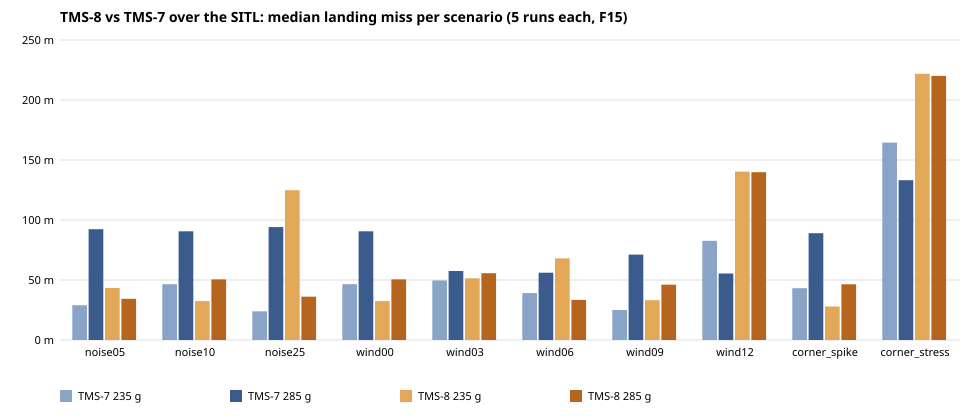

# TMS-8 — pre-flight study over the SITL: the flat flying-wing frame against TMS-7, F15 at 235 and 285 g

**What it asks.** TMS-8 (`doc/plan.md`, "TMS-8, as the operator set it out", 2026-10-11) is a flat triangle frame
with fixed tips and a tail, no folding wings, the same booster, servos and electronics as TMS-7. The planning
figures: **L/D 8 at a 12 m/s trim** (TMS-7: 5.5 at 14 m/s), the stall unchanged (9 m/s), and an estimated boost CdA
of **0.0020 m²** (TMS-7's stack: 0.0010) for the open frame ~5 cm deep and 20 cm wide with 2 cm tips. Does it land
better or worse than TMS-7, at which mass, and how much does the drag estimate matter?

**How it was flown.** `tools/sitl_matrix.py`: the Rust flight code (the SITL, M14) flown lockstep against
`sim_model` with `--airframe tms7|tms8`, the board's HITL copy of the taster's own config, F15. The pre-flight
report's ten scenarios (calm, noise, wind 0-12 m/s, a spike, a stress corner) x 5 seeded runs x 2 masses x 2
airframes = **200 flights**, scored by the physics itself: the body's landing point against the HPRC zone (a strip
~40 m N-S x ~187 m E-W), the time from ignition to DONE, the apogee. Then a drag sweep for TMS-8: CdA 0.0015,
0.0020, 0.0025, 0.0030 m² x 2 masses x 10 scenarios x 2 runs = 80 flights. Data: `runs.csv`, `summary.csv`,
`drag_runs.csv`, `drag_summary.csv` (';').

**The SITL reproduces the board.** TMS-7 here against the 90 board HITL flights of
[TMS-7-preflight](../TMS-7-preflight/): 235 g lands at a **42.3 m** median (board: 37-46 m) with 35/50 in the zone
(board: 7/10 scenarios); 285 g at **88.8 m** (board: 88-91 m), 0/50 (board: 0/10). So the TMS-8 numbers below sit on
the same footing as the pre-flight report's.

## The headline

| | median miss | in the zone | median time aloft | median apogee |
|---|---|---|---|---|
| TMS-7, 235 g | 42.3 m | 35 / 50 | 112 s | 324 m |
| TMS-7, 285 g | 88.8 m | 0 / 50 | 97 s | 273 m |
| **TMS-8, 235 g** | **51.8 m** | **10 / 50** | **132 s** | **263 m** |
| **TMS-8, 285 g** | **48.0 m** | **26 / 50** | **116 s** | **231 m** |

- **TMS-8 flies at 285 g as TMS-7 flies at 235 g:** a 48 m median against 42 m, half its flights in the zone. The open
  frame costs ~15 % of the height (231 against 273 m at 285 g) and the better glide gives it back in time: 116 s
  aloft, where TMS-7 at the same mass manages 97 s and lands twice as far out.
- **At 235 g TMS-8 stays up longest (132 s) and lands worse.** It comes down 30-45 m from the centre, just outside the
  40 m-wide strip, in the calm and noise scenarios where 285 g lands inside. The endgame's orbit phase decides it,
  not the energy: the endgame lottery of [TMS-7-catapult_evaluation](../TMS-7-catapult_evaluation/) again.
- **Wind is TMS-8's weak side.** At 12 m/s, its own trim speed, it cannot make headway: 140 m at either mass, where
  TMS-7 manages 55-83 m; the stress corner (12 m/s with noise and spikes) costs it 220 m. Up to 9 m/s it holds its
  own.

| scenario | TMS-7 235 g | TMS-7 285 g | TMS-8 235 g | TMS-8 285 g |
|---|---|---|---|---|
| noise05 | 29 m, 5/5 | 92 m, 0/5 | 43 m, 0/5 | 34 m, 5/5 |
| noise10 | 46 m, 5/5 | 91 m, 0/5 | 32 m, 0/5 | 50 m, 5/5 |
| noise25 | 24 m, 5/5 | 94 m, 0/5 | 125 m, 0/5 | 36 m, 1/5 |
| wind00 | 46 m, 5/5 | 91 m, 0/5 | 32 m, 0/5 | 50 m, 5/5 |
| wind03 | 50 m, 5/5 | 58 m, 0/5 | 51 m, 5/5 | 56 m, 0/5 |
| wind06 | 39 m, 5/5 | 56 m, 0/5 | 68 m, 5/5 | 33 m, 5/5 |
| wind09 | 25 m, 0/5 | 71 m, 0/5 | 33 m, 0/5 | 46 m, 0/5 |
| wind12 | 83 m, 0/5 | 55 m, 0/5 | 140 m, 0/5 | 140 m, 0/5 |
| corner_spike | 43 m, 5/5 | 89 m, 0/5 | 28 m, 0/5 | 46 m, 5/5 |
| corner_stress | 164 m, 0/5 | 133 m, 0/5 | 222 m, 0/5 | 220 m, 0/5 |

(median miss over the five runs, then the runs in the zone; `wind00` and `noise10` are the same conditions)

## The boost drag

| boost CdA (m²) | 235 g: apogee, median miss, in zone | 285 g: apogee, median miss, in zone |
|---|---|---|
| 0.0015 | 290 m, 49 m, 9/20 (4 still flying at the 150 s cap) | 250 m, 78 m, 4/20 |
| **0.0020 (the estimate)** | **263 m, 52 m, 4/20** | **231 m, 51 m, 11/20** |
| 0.0025 | 243 m, 83 m, 3/20 | 215 m, 19 m, 12/20 |
| 0.0030 | 227 m, 37 m, 13/20 | 203 m, 54 m, 6/20 |

- **The apogee follows the drag smoothly:** ±~30 m around the estimate over the range a printed frame could land in.
- **The landing does not.** The medians jump 19-83 m with no trend, because a few metres of height move the endgame
  orbit's phase at touchdown. That is the pre-flight report's trust bar again: a single condition needs ~30 m to mean
  anything; the matrix median is the number to quote.

## What it means for the build

- **Fly TMS-8 at 285 g** (the full build): it matches TMS-7's best combination, and needs no lightening.
- **Keep it out of strong wind**, or give it a faster trim on windy days (a forward CG or a pitch trim): at 12 m/s
  trim speed, a 12 m/s wind stalls its progress.
- **Measure the real TMS-8 before trusting any of this.** The polar (L/D 8 at 12 m/s), the boost CdA and the control
  response are planning figures, and the control law flies TMS-7's gains; a measured glide (a catapult or a hand
  launch, as for TMS-7's polar) replaces `AIRFRAMES['tms8']` and this study re-flies in three minutes.

Re-run: `tools/sitl_matrix.py --config <a board's saved config> -o <dir>` (the study) and
`... --airframes tms8 --runs 2 --boost-cdas 0.0015 0.0020 0.0025 0.0030` (the sweep).

## On the board (2026-10-13): HITL on the taster, the Python collection's charts, and video

**How it was flown.** The taster (Rust firmware, realtime HITL, real SG90s on the INA226 rail) flew TMS-8 as the
SITL study picked it: F15, **285 g**, `--airframe tms8`, the firmware's defaults of the day (the 3-degree fin grid,
the endgame's turn kept across the heading wrap). Three independent runs of the ten scenarios (r1-r3), then the
operator's **video run** (`hitl_host --video`: the ten again with the camera recording through the flight; its
corner_stress pulled from the card again after a full host disk) and one random scenario per plain run flown again with video (the
pairs). 43 flights. r1 and r2 flew `69a4496`, r3 and the video flights `15cb17f` (the same flight law, plus the
`runtime.csv` stream). The SITL reference is the same law at HEAD, 20 seeds a scenario (`board/sitl_head_*.csv`).

Charts as the Python preflight's (`doc/sims/TMS-7-preflight`), now that its tools read a Rust cut
(`flight_telemetry.load_cut`): per flight `board/<run>_report_<scenario>.svg` (the ground track with the zone, the
altitude and roll), the noise and wind overlays `board/<run>_compare_{noise,wind}.svg`, and the interactive 11-panel
`flight_report` for a pair and a video flight (`board/r1_report_wind00{,_video}.html`, `board/rv_report_noise05.html`:
the 3D track coloured by stage, |a|, altitude, speed, attitude, fins, health, power, gyro, airspeed, control
authority, every stage marked). The summary: `board/board_vs_sitl.html`. Data: `board/board.csv` (per flight),
`board/board_vs_sitl.csv`, `board/video_pairs.csv`, `board/video_run.csv`, and `board/comparison.json` (hitl_compare:
every panel quantity across r1-r3).

### The board flies what the SITL predicts

| scenario | board r1 / r2 / r3 miss | in zone | SITL median (20 seeds' range) | SITL in zone |
|---|---|---|---|---|
| noise05 | 27.1 / 43.3 / 37.1 m | 3/3 | 35.1 (26.4-42.2) | 20/20 |
| noise10 | 57.3 / 56.2 / 59.3 m | 3/3 | 52.5 (43.0-64.7) | 19/20 |
| noise25 | 6.1 / 29.7 / 4.0 m | 3/3 | 21.9 (5.3-60.6) | 19/20 |
| wind00 | 57.7 / 61.0 / 70.9 m | 1/3 | 52.5 (43.0-64.7) | 19/20 |
| wind03 | 49.0 / 46.1 / 50.1 m | 1/3 | 50.5 (48.0-59.4) | 0/20 |
| wind06 | 32.6 / 32.7 / 32.0 m | 3/3 | 33.4 (27.2-34.5) | 20/20 |
| wind09 | 43.6 / 43.7 / 43.1 m | 3/3 | 45.7 (42.4-49.0) | 0/20 |
| wind12 | 137.0 / 136.2 / 138.8 m | 0/3 | 138.8 (136.2-140.9) | 0/20 |
| corner_spike | 62.9 / 60.2 / 52.4 m | 2/3 | 46.6 (31.7-62.9) | 19/20 |
| corner_stress | 218.7 / 220.8 / 220.6 m | 0/3 | 220.3 (213.5-235.9) | 0/20 |

- **19 of 30 board flights land in the zone**; the runs' medians are 53.1 / 51.2 / 51.2 m (in zone 6 / 6 / 7). The
  SITL at HEAD: median 48.1 m, 116 of 200 in the zone.
- **Scenario by scenario the board sits in the SITL's range**, wind to the decimetre (wind06 32.0-32.7 m against
  27.2-34.5). The apogee agrees within 1 % (231-233 m against 231 m); the board stays aloft 1-6 s longer.
- The "in zone" split at 43-50 m is the strip's geometry (40 m wide): wind03 and wind09 land just outside on both.
- **The runs repeat:** across r1-r3 hitl_compare finds no anomaly in the ten scenarios (no channel missing, no
  value outside its physical range); the widest spreads are the chaotic quantities (the fin cap's low point, the gyro
  ranges), as in the Python preflight.

### What video costs the board

The thirteen video flights (the video run and the three pairs) against the thirty plain ones:

| | plain (median, range) | video (median, range) |
|---|---|---|
| control tick's longest work | 0.49 ms (0.45-0.58) | **1.05 ms** (0.91-1.56) |
| control tick's worst lateness | 13 us (9-22) | 55 us (39-81) |
| control overruns | 0 | 0 |
| core 0 mean load | 48 % | **60 %** |
| heap free, lowest | 23.1 MB | **9.6 MB** (the camera's buffers) |
| board temperature, highest | 37.3 °C | **44.3 °C** |
| flash-to-SD saver lag | 0.7 s (max 24 s) | 0.5 s (**max 63 s**) |
| SD busy | -- | 43 % |
| video | -- | ~3,060 frames a flight (25 fps), 1.7 % missed (max 2.7 %), 0 dropped |
| in the zone | 19 / 30 | 9 / 13 |

- **The flight is unaffected:** no overrun in 43 flights, the landing as without video. The control tick's longest
  work doubles and still takes about a tenth of the 10 ms tick.
- **Core 1 has room:** `runtime.csv` (r3 and the video flights) shows core 1, the control loop and the buses, at
  1-4 % through a video flight, core 0 at 42-91 %. Moving the recorder's threads to core 1 below the control
  priorities is the lever if core 0 ever runs short (static affinity, from a per-thread `load` profile first).
- **Watch the saver on a long flight:** the 63 s backlog is well inside the 20 MiB flash ring, but it is the camera
  and the saver sharing the card.
- **Open: the servo rail reads 15-20 J lower with video** (61 against 76 J). The fins move the same degrees (r3: 27.9k
  against 27.5k) and the rail's voltage is the same (4.68-4.71 V in flight); the INA226 averages 9 ms of every 100,
  so the camera's load may shift its sampling phase against the 100 Hz fin moves. A 1 kHz bench capture settles it;
  until then it is no finding.
